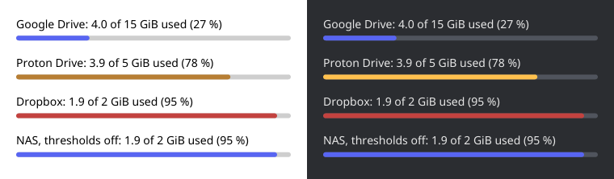

# iced_storage_bar

A rounded bar for [iced](https://github.com/iced-rs/iced) that shows how much of a quota is used and colours itself by how full it is.



- **Accent** below the warning threshold (default 70 %)
- **Warning** from the warning threshold on
- **Danger** from the danger threshold on (default 90 %)

Either threshold can be moved or turned off.

## Usage

```toml
[dependencies]
iced-storage-bar = "0.1"
# with `serde` to keep the thresholds in a settings file:
iced-storage-bar = { version = "0.1", features = ["serde"] }
```

```rust
use iced_storage_bar::{Thresholds, fraction, storage_bar};

// 4 of 5 GiB used: warning colour, 6 px high, as wide as its container.
storage_bar(fraction(used_bytes, total_bytes)).height(6.0)

// Other thresholds, no warning colour, your own colours.
storage_bar(0.82)
    .warning_at(None)
    .danger_at(0.95)
    .style(|theme| iced_storage_bar::Style { track: theme.extended_palette().background.weak.color, ..iced_storage_bar::default(theme) })

// Thresholds from the app's settings, changeable at any time.
storage_bar(0.82).thresholds(settings.storage_bar) // a `Thresholds`; Thresholds::NONE turns both off
```

The bar is rebuilt in every `view`, so a change to the settings shows on the next draw. With the `serde` feature, `Thresholds` reads `{"warning": 0.8, "danger": null}`: a missing field keeps its default, `null` turns it off.

Without `.style`, the colours come from the theme's palette and follow theme switches: primary, warning and danger, on the strong background as the track.

It builds on `iced_widget` 0.14 only. An app on an iced fork patches `iced_widget` with the fork's, so Cargo builds one copy of iced:

```toml
[patch.crates-io]
iced_widget = { git = "https://github.com/your/iced", tag = "your-tag" }
```

`cargo run --example demo` shows the bars above.

## License

MIT, see [LICENSE](LICENSE).
